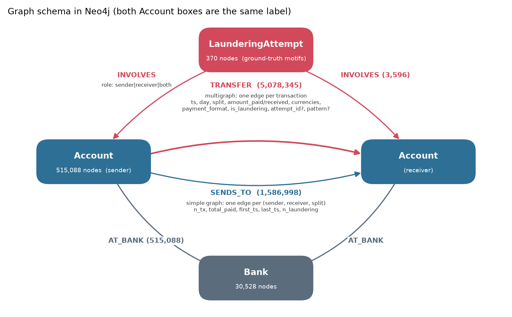
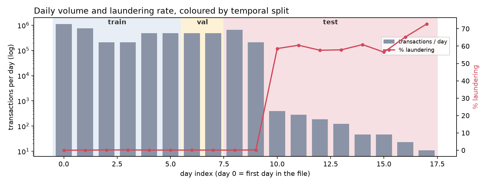
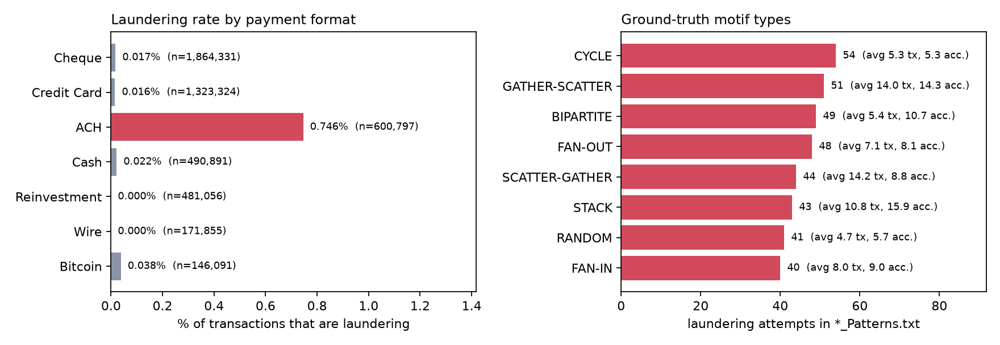
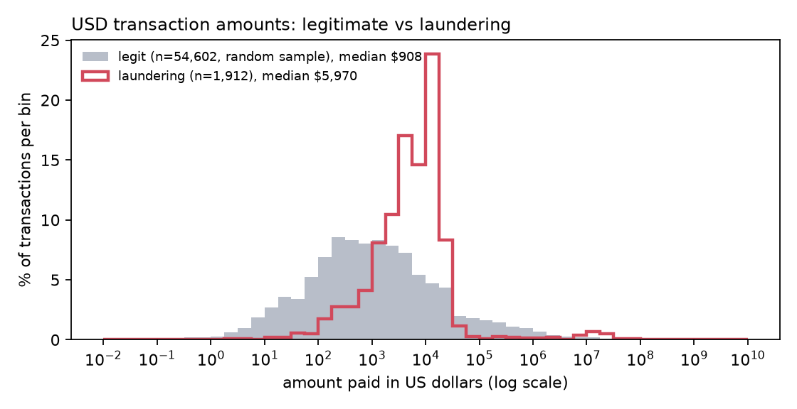
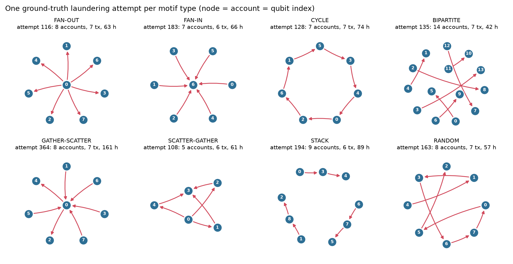
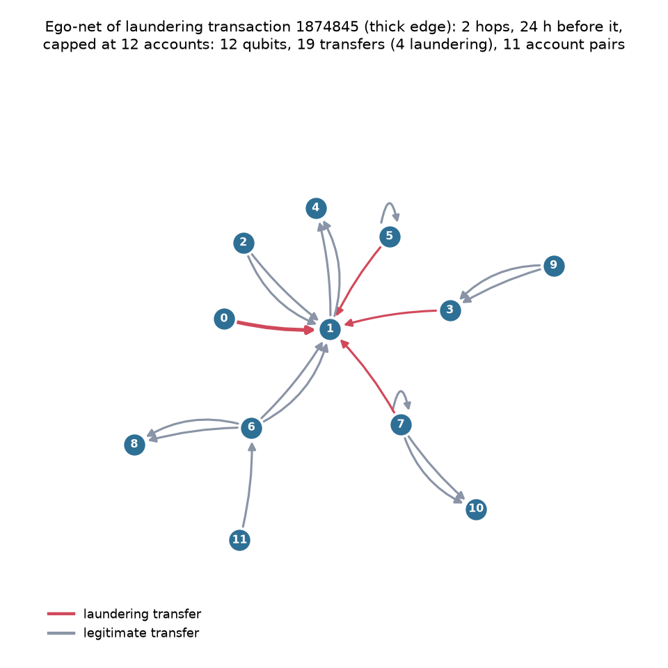

# HI-Small: dataset summary (from Neo4j)

All numbers and figures come from Cypher queries against the full HI-Small graph loaded in Neo4j
(`scripts/neo4j_load.py`). Regenerate with:

```bash
uv run python scripts/dataset_summary.py --name HI-Small
```

Raw numbers are in [`stats.json`](stats.json). Data: IBM AML synthetic transactions, HI ("higher illicit")
Small variant. Loaded and checked on 2026-11-05.

## At a glance

| | |
|---|---|
| Transactions (`TRANSFER` edges) | **5,078,345** over 18 days (2022-09-01 to 2022-09-18) |
| Accounts / banks | 515,088 accounts at 30,528 banks |
| Laundering transactions | **5,177 (0.102 %, about 1 in 980)** |
| Accounts touching laundering | 6,357 (1.2 % of accounts) |
| Ground-truth attempts (`*_Patterns.txt`) | 370 attempts, 3,209 transactions, 8 motif types |
| Laundering transactions not in any pattern | 1,968 (38 %): labelled but without a motif label |
| Distinct (sender, receiver, split) pairs | 1,586,998: **87 % of transactions repeat an existing pair** (max 54 on one pair) |
| Self-transfers (a → a) | 591,212 (11.6 %); 81 % are `Reinvestment` (every Reinvestment is a self-transfer); only 11 are laundering |
| Cross-bank transactions | 86 % of all, but **98 % of laundering** |
| Degree (transactions per account) | median 2 out / 2 in; p99 91 out / 50 in; one hub sends 168,672 |

## Schema



One node per account (`<bank>:<account>`) and bank. Two views of the same edges:

- **`TRANSFER`**: the directed temporal **multigraph**, one edge per transaction, with timestamp, amounts,
  currencies, payment format, label and, for pattern transactions, `attempt_id` and `pattern`.
- **`SENDS_TO`**: the same edges collapsed to a **simple weighted graph**, one edge per (sender, receiver, split).
  This is the "one qubit per account, one entangler per account pair" view.

`LaunderingAttempt` nodes hold the 370 ground-truth motif instances and link to their accounts with `INVOLVES`.

## Time and the temporal split



| split | days | transactions | laundering | rate |
|---|---|---|---|---|
| train | 0–5 (Sep 1–6) | 3,248,921 | 2,530 | 0.078 % |
| val | 6–7 (Sep 7–8) | 965,524 | 1,036 | 0.107 % |
| test | 8–17 (Sep 9–18) | 863,900 | 1,611 | 0.186 % |

**Caveat: the data has a "laundering tail".** Normal traffic stops after day 9. Days 10–17 contain only
1,108 transactions, and **655 of them (59 %) are laundering**. These are attempts that finish after the
legitimate simulation ends. That is 41 % of all test positives. A model that uses time or activity
features can detect them trivially, and the test-split metrics will look better than they really are.
**Report test metrics on days 8–9 only, as well as on the full test split.**

Motifs also cross split boundaries: the CYCLE example below starts on Sep 4 (train) and ends on Sep 7 (val).

## What distinguishes laundering



- **ACH carries 87 % of the laundering** (4,483 of 5,177), at a rate of 0.75 %, about 7× the base rate.
  Reinvestment and Wire have no laundering at all.
- Motif types are balanced (40–54 attempts each). In size they range from small (CYCLE, RANDOM: about 5 accounts)
  to large (GATHER-SCATTER, STACK: 14–16 accounts on average, **up to 29 and 45**).
- Attempts are slow: they take **21–129 hours on average** (BIPARTITE is the fastest, GATHER-SCATTER the slowest).



Amounts are in the payment currency, so the histogram uses USD-paid transactions only. Laundering
amounts are higher (median $5,970 vs $908) and concentrated between $1k and $20k. Legitimate amounts
cover a much wider range.

## Motif examples



One real attempt per type, drawn as the subgraph a quantum circuit would see (node number = qubit index).

Transactions of the **CYCLE** attempt 128, in cycle order:

| # | time (UTC) | sender → receiver | amount | currency | format |
|---|---|---|---|---|---|
| 1 | 2022-09-04 12:14 | `0214615:80E9CE540` → `0010232:808FADF50` | 10,162.68 | US Dollar | ACH |
| 2 | 2022-09-07 10:06 | `0010232:808FADF50` → `016224:8052D0490` | 10,162.68 | US Dollar | ACH |
| 3 | 2022-09-07 06:35 | `016224:8052D0490` → `028627:805565C40` | 10,044.53 | Euro | ACH |
| 4 | 2022-09-06 11:30 | `028627:805565C40` → `0117143:806ABE0A0` | 837,770.27 | Ruble | ACH |
| 5 | 2022-09-07 14:34 | `0117143:806ABE0A0` → `028255:804D7E820` | 11,657.93 | US Dollar | ACH |
| 6 | 2022-09-07 02:39 | `028255:804D7E820` → `0212789:805CA3750` | 795,290.07 | Rupee | ACH |
| 7 | 2022-09-07 09:19 | `0212789:805CA3750` → `0214615:80E9CE540` | 10,828.52 | US Dollar | ACH |

What this example shows:
- **The value stays about the same (≈ $10k) while the currency changes** (USD → EUR → RUB → INR → USD).
  Every hop uses ACH, and every account is at a different bank.
- **The cycle is not time-ordered:** hop 4 happens before hop 3. Queries or features that need strictly
  increasing timestamps (for example query 5 in `cypher/aml_queries.cypher`) miss cycles like this one.
  Treat the order of the hops as unknown.

## What a quantum model sees: an ego-net



`GraphDB.ego_subgraph(edge_id, hops=2, max_nodes=12)` around a laundering transfer uses only the 24 h
before it, so no future edges leak in. Result: 12 accounts = 12 qubits, 19 transfers, 11 distinct account pairs
(that is, 11 entanglers if there is one per pair). Here three other laundering transfers go into the same
account (1), the start of a FAN-IN. The rest is ordinary traffic, including self-transfers and repeated pairs.

## What this means for the prototype

1. **Extreme imbalance (1 : 980) and only 370 motif instances.** Use minority-class F1, PR-AUC and recall at
   a fixed FPR. The positive class is small enough that sample efficiency matters.
2. **The signal is in the structure, not in single edges.** 98 % of laundering crosses banks, it goes through
   one payment channel (ACH), and the value is kept across hops and currencies. All of these are relations
   *between* edges in a small subgraph, which is what a graph-structured circuit encodes.
3. **Qubit budget:** most motifs have ≤ 16 accounts (mean 5–16), but GATHER-SCATTER and STACK go up to 29–45.
   Cap ego-nets at 12–16 accounts and state that large motifs are seen only in part.
4. **Time window:** attempts last 1–5 days on average. A 24 h window sees only part of a motif.
   Try windows of 3–5 days and compare.
5. **Multigraph → simple graph:** 87 % of transactions repeat a pair. Collapse parallel edges (`SENDS_TO` /
   `Subgraph.simple_edges()`) into edge weights (count, total amount) rather than spending gates per transaction.
6. **Evaluation:** watch the laundering tail (days 10–17) and motifs that cross split boundaries (see above).
